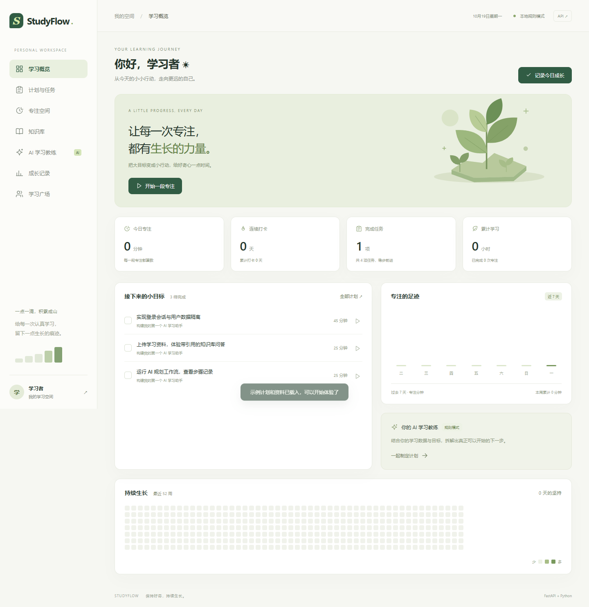
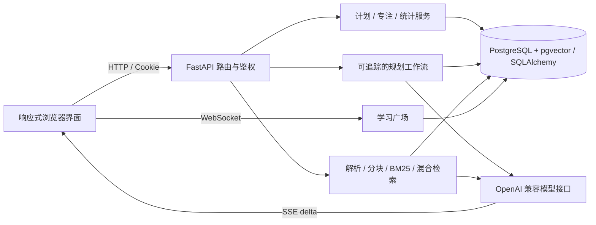

# StudyFlow · AI 学习成长平台

基于 **Python + FastAPI + SQLAlchemy + PostgreSQL + pgvector** 的完整学习管理项目，围绕「计划 → 任务 → 专注 → 打卡统计 → AI 制定下一步」构建业务闭环。参考 Summer Checkin 的业务思路，重新设计后端与界面；原仓库分析见 [项目分析](docs/PROJECT_ANALYSIS.md)。

前端使用 HTML / CSS / 原生 JavaScript，通过 HTTP、SSE、WebSocket 与 FastAPI 通信，由同一服务托管，无需 Node 构建步骤。适合本地演示、学习后端设计，以及继续发展成求职作品。



## 1. 启动

要求 Python 3.12+，并启动 Docker Desktop。PostgreSQL 使用独立的 pgvector 容器。在 PowerShell 中运行：

```powershell
# 下载或克隆仓库后，进入项目根目录
cd studyflow
.\start.ps1
```

脚本会检查依赖、准备本地数据库凭据、启动 PostgreSQL、等待健康检查、执行 Alembic 迁移，再启动开发服务器。支持定位安装在当前用户目录的 Docker Desktop。如果本机执行策略禁止 PowerShell 脚本，可直接运行：

```powershell
python -m venv .venv
.\.venv\Scripts\python -m pip install -r requirements.lock.txt
.\.venv\Scripts\python scripts/setup_postgres.py
docker compose up -d --wait postgres
.\.venv\Scripts\python -m alembic upgrade head
.\.venv\Scripts\python -m uvicorn app.main:app --reload --host 127.0.0.1 --port 8000
```

- 页面：[http://127.0.0.1:8000](http://127.0.0.1:8000)
- 交互接口文档：[http://127.0.0.1:8000/docs](http://127.0.0.1:8000/docs)
- 健康检查：[http://127.0.0.1:8000/health](http://127.0.0.1:8000/health)

业务数据库为 PostgreSQL，库名和用户名均为 `studyflow`，本机端口 `5433`，随机密码只保存在已忽略的 `.env` 中，数据持久化到 Docker 专用卷。结构由 Alembic 管理，向量使用 `vector(1024)` 与 HNSW 余弦索引。注册后可点击 **载入示例资料**。已有 SQLite 数据的升级、备份与恢复见 [数据库迁移说明](docs/DATABASE.md)。

## 2. 已实现功能

| 模块 | 实际行为 |
| --- | --- |
| 账户 | 注册、登录、退出；scrypt 密码散列，服务端保存会话 token 的 SHA-256 摘要，HttpOnly / SameSite Cookie |
| 计划任务 | 创建、删除计划，添加、删除、完成任务，按任务计算进度 |
| 每日打卡 | Asia/Shanghai 日期口径，数据库唯一约束去重，连续天数统计 |
| 专注 | 可关联任务；服务端记录开始时间，完成时校验时长，刷新恢复倒计时，幂等完成，取消不计时 |
| 成长记录 | 今日 / 累计专注、完成任务、7 日趋势、52 周学习日历 |
| 知识库 | MD / TXT / PDF / DOCX 解析、分块、去重、用户隔离、来源阅读、文档范围问答和原地重建向量索引 |
| 检索问答 | 本地 BM25 + PostgreSQL pgvector 余弦检索 + RRF；HNSW 索引及用户 / 模型过滤，查询只返回片段 ID 和距离；模型通过 SSE 输出 |
| 学习教练 | 读取学习数据与用户偏好 → 生成计划 → Pydantic 校验 → 用户确认 → 事务写入任务；步骤记录可查看 |
| 学习广场 | Cookie 鉴权的 WebSocket 群聊、最近 50 条历史、最多 100 条前端消息、在线人数、断线重连、消息限流 |
| 工程保障 | 请求体上限、同源写入检查、请求 ID 和耗时日志、AI 每日额度、pytest、浏览器回归脚本、CI、Docker 配置 |

## 3. AI 配置与真实能力边界

不配置密钥也能运行全部本地业务。默认：

- 教练使用**明确标识的规则规划**，不是大模型推理。
- 知识库使用 **BM25** 检索并展示**原文摘录**，不会假装生成了答案。
- 用户主动填写的学习偏好作为持久上下文注入，不做自动记忆提取。

要接入模型：

```powershell
.\.venv\Scripts\python scripts/setup_postgres.py
```

编辑 `.env` 后需要重新加载服务，单独刷新网页不会更新后端配置。使用新版 `start.ps1` 启动时会监视 `.env` 修改并自动重启；使用其他启动方式时请手动停止并启动服务。

先检查配置是否已读取（不显示密钥），或发起少量真实请求诊断接口兼容性：

```powershell
.\.venv\Scripts\python scripts/check_ai.py
# 会发起少量模型请求，可能产生少量 token 费用；只发送内置测试文本。
.\.venv\Scripts\python scripts/check_ai.py --probe
```

对话功能需要以下三个配置与供应商控制台一致：

```dotenv
AI_API_KEY=你的密钥
AI_BASE_URL=https://你的服务/v1
AI_MODEL=你的对话模型名
AI_DAILY_REQUEST_LIMIT=50
```

供应商需要兼容 `/chat/completions`，规划需要 JSON object 输出，问答需要 SSE 流式响应。不同兼容服务对 `response_format`、`stream_options` 的支持可能不同。

可独立配置 Embedding（密钥不与对话模型隐式共用）：

```dotenv
EMBEDDING_API_KEY=你的向量服务密钥
EMBEDDING_BASE_URL=https://你的向量服务/v1
EMBEDDING_MODEL=你的向量模型名
```

请直接编辑已有 `.env`，不要用示例覆盖现有密钥。配置后**新上传**的文档会生成向量。已有文档可点击资料右侧的 **重建向量索引** 按钮，无需删除原文；新向量全部生成成功后才事务替换旧索引，失败时保留原数据。列表会显示向量是否就绪，问答可以选择全部资料或单份文档。当前没有后台索引队列。

向量记录模型名，检索时不会混用不同模型。生产向量列固定为 1024 维，接口显式请求此维度并校验结果；切换模型后需要重建对应向量。阿里云 `text-embedding-v3` / `v4` 每批不超过 10 条文本。使用同一百炼空间且具有权限时，可将 `EMBEDDING_API_KEY=${AI_API_KEY}`、`EMBEDDING_BASE_URL=${AI_BASE_URL}`，并设置 `EMBEDDING_MODEL=text-embedding-v3`。

模型失败时规划返回带提示的规则草稿；问答流会显示错误，保留可阅读的来源；检索时向量服务失败会降级到 BM25，来源元数据包含提示。上传向量化失败不会保存半份索引。

请求额度按用户和日期通过数据库条件更新扣减，失败请求同样占一次额度；上传向量化、向量查询也占额度。`AIUsage.tokens` 保存模型实际返回的用量，供应商不返回时保持 0，不推算 token。额度是**请求次数**，不是费用精确控制。

自动化测试使用替身响应；另已对当前配置的 `qwen-plus` 做过少量真实接口检查，结构化计划与流式回答均通过。完整真实资料的回答质量与向量检索仍需按自己的供应商配置进行联调和评测。

## 4. 架构与数据流



```text
app/
  main.py             应用生命周期、路由、同源策略和访问日志
  middleware.py       包括 chunked 请求在内的 6 MiB 请求体上限
  config.py           环境变量配置
  database.py         数据库连接与请求级 Session
  schema.py           Alembic 升级与启动时版本检查
  models.py           业务模型、外键、唯一约束与部分索引
  schemas.py          请求及模型输出结构校验
  security.py         密码、会话、当前用户依赖
  routes/             账户、学习、知识库、规划与聊天接口
  services/           学习统计、模型适配、RAG、规划工作流
  static/             页面、样式与前端交互
tests/                API / 业务 / AI 降级 / 检索测试
scripts/              数据迁移、隔离 PostgreSQL 测试、浏览器回归与检索评估
migrations/           Alembic 表结构、vector 扩展与 HNSW 索引迁移
docs/                 项目分析、设计说明、求职展示指南与截图
```

关键设计与取舍见 [架构说明](docs/ARCHITECTURE.md)。

## 5. 测试与评估

```powershell
.\.venv\Scripts\python -m pytest -q
.\.venv\Scripts\python scripts/test_postgres.py
.\.venv\Scripts\ruff check app tests scripts migrations
.\.venv\Scripts\ruff format --check app tests scripts migrations
node --check app/static/app.js
.\.venv\Scripts\python scripts/evaluate_retrieval.py
```

浏览器回归需要安装开发依赖，并安装 Google Chrome：

```powershell
.\.venv\Scripts\python -m pip install -r requirements-dev.txt
.\.venv\Scripts\python scripts/browser_smoke.py
.\.venv\Scripts\python scripts/test_postgres.py --browser
```

默认 pytest 使用临时 SQLite，保留轻量回归能力。`test_postgres.py` 会创建随机 `studyflow_test_*` 数据库，验证真实迁移、原生 vector 列、HNSW 索引、用户隔离、并发写入、文档范围检索与索引重建，结束后只清理本次创建的测试库。当前 PostgreSQL **30 项测试全部通过**；SQLite 为 27 项通过、3 项原生 PG 测试跳过。

浏览器脚本验证注册、任务、打卡、知识引用、规划确认、专注刷新恢复、聊天转义、移动端布局等，PostgreSQL 模式已通过，未发现 JavaScript 运行错误。截图和日志放在已忽略的 `test-results/`。不会使用业务数据库或调用付费模型。CI 同时运行 SQLite 与 PostgreSQL 测试，并通过 `alembic check` 检查结构漂移。

检索评估包含 8 条手写问题、8 条资料，输出 Hit@1、Hit@3、MRR。它是可复现的冒烟集，**不能据此声称生产检索准确率或回答准确率**，也不衡量生成内容质量。

## 6. Docker

```powershell
python scripts/setup_postgres.py
# 只运行数据库，Python 应用仍通过 start.ps1 启动：
docker compose up -d --wait postgres
# 或将应用和数据库都放进容器（需要先停止本机 8000 端口的应用）：
docker compose --profile app up --build -d
```

PostgreSQL 数据卷为 `studyflow_studyflow-postgres-data`，容器为 `studyflow-postgres-1`，只绑定本机 5433 端口。应用容器采用非 root 用户、单 worker，启动先执行 Alembic。数据库容器、本机 Python 应用和 PostgreSQL 浏览器流程已实跑验证。

公开部署时，在反向代理设置 HTTPS、请求体上限与 WebSocket 转发，并设置 `COOKIE_SECURE=true`。SSE 路由需要关闭代理缓冲。当前群聊连接与登录限流存在单进程内存中，**不要直接开启多个 worker**，扩容应先接入 Redis 广播和共享限流。

## 7. 当前规模与下一步

- 采用 PostgreSQL 和同步 ORM，未做性能压测，不声称生产高并发能力。SQLite 只作为测试兼容和旧数据回退选项。
- 向量检索由数据库执行，建立 HNSW 索引；小数据时优化器可能选择普通索引 / 顺序扫描。它是近似检索，不保证任意规模下的精确召回。BM25 仍在应用中计算并读取用户文本，后续应接入倒排索引。
- 规划是显式编排的工具工作流，不是通用自主 Agent，也不依赖 LangChain / LangGraph。
- 文档导入和规划在单次请求完成，没有 Celery / Redis 后台队列；扫描 PDF 暂不支持 OCR。
- PostgreSQL 表结构由 Alembic 版本化管理，启动检查是否升级到最新版本；已有 SQLite 迁移工具带备份、事务和完整性校验。
- 没有 3D 小岛、OSS 头像、自动周报推送、复杂文档工作室。围绕学习闭环完成可验证的核心实现。

优先演进：真实资料质量评测与性能基准 → 数据库倒排检索 → 后台索引任务 → Redis 跨进程广播与限流 → 前端模块化与组件框架。

## 8. 求职展示

详见 [简历描述、五分钟演示与面试问题](docs/PORTFOLIO.md)。按自己实际理解、参与与部署情况调整，不把尚未接入的基础设施写成已完成，也不虚构效果提升数字。

首次体验可按 [三分钟演示说明](docs/DEMO.md) 操作。仓库提供 [FastAPI 示例资料](examples/knowledge/fastapi-notes.md) 和 [RAG 示例资料](examples/knowledge/rag-notes.md)，不含真实用户数据。Linux / macOS 可在 Python 3.12+ 与 Docker 就绪后执行 `sh start.sh`。

参考实现与许可证说明见 [THIRD_PARTY_NOTICES.md](THIRD_PARTY_NOTICES.md)。框架用法参考 [FastAPI 生命周期与测试文档](https://fastapi.tiangolo.com/advanced/testing-events/) 和 [SQLAlchemy Session 文档](https://docs.sqlalchemy.org/en/20/orm/session_basics.html)。
