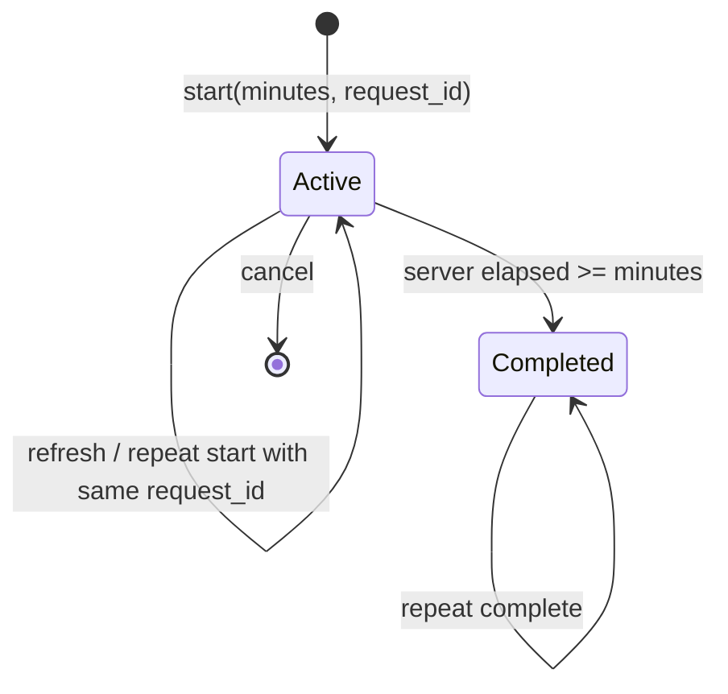

# 设计说明

## 数据隔离与会话

登录生成随机会话 token，浏览器通过 HttpOnly、SameSite=Strict Cookie 保存；服务端只保存 token 摘要。每个请求通过 `current_user` 校验有效期和会话是否被撤销。密码使用带随机盐的 scrypt。退出删除服务端会话，旧 Cookie 无法复用。

业务接口从会话获取 user_id，不接受客户端替换用户身份。列表、知识检索按 user_id 过滤；按 ID 修改前检查所有者。越权返回 404。群聊明确是所有已登录用户共享的公共区域。

同源检查和 SameSite Cookie 保护写操作；WebSocket 握手检查 Origin 与 Cookie，收消息时重新检查会话。前端以文本或 HTML 转义展示用户输入与模型输出，不直接执行文档或 Markdown 中的 HTML。

## 专注计时与幂等

数据库约束：`(user_id, request_id)` 唯一；`completed_at IS NULL` 条件下 user_id 唯一，保证每人最多一个活动专注。客户端只显示 ends_at 倒计时；服务端用自己的时间确认完成。累计统计只读 completed_at 非空记录，同一个记录多次完成不会新增时长。关联任务完成状态由用户单独勾选，计时结束不意味着任务一定完成。

这是计时记录，不是在线监考：离开页面后时间继续流逝，无法证明用户一直在学习。跨天专注归属完成日期。

## 学习规划工作流

1. 预留当日请求额度，记录用量。
2. 创建 AgentRun，读取学习统计、计划进度、偏好。
3. 将目标与上下文传给兼容模型，要求 JSON 输出。
4. 用 AgentDraft / TaskInput 校验任务条数、标题、预计时长；失败时明确标识规则降级。
5. 保存草稿和步骤，状态变为 `awaiting_approval`。
6. 确认时使用 `UPDATE ... WHERE status='awaiting_approval'` 竞争执行权，在同一事务中创建 Plan / Task 并完成 Run。
7. 顺序重复确认返回已创建 plan_id；并发竞争失败返回 409；拒绝后的草稿不能再执行。

工具步骤是编排执行记录，模型只负责生成草稿，不拥有任意数据库或代码执行权限。这是具有用户确认环节的规划工作流，没有通用自主工具选择循环，也没有后台任务恢复机制。

## 知识库链路

导入：扩展名检查 → 文件 / 文本大小限制 → 解析 → 正文 SHA-256 去重 → 分块 → 可选向量化 → 事务入库。文本按约 600 字分块、重叠 80 字，尽量沿换行或句号截断；切分位置必须向前移动。DOCX 检查解压体积；PDF 限制页数，扫描件提示先 OCR。

检索：

- BM25 使用英文单词、中文单字及相邻双字特征。
- PostgreSQL 使用 `vector(1024)` 原生列。Embedding 接口显式请求并校验 1024 维、有限数值、结果数量；每批最多 10 条。查询使用 `<=>` 余弦距离，按当前用户与模型过滤，只返回 ID 和距离；向量不出库。
- 建立 `vector_cosine_ops` HNSW 索引；查询启用事务级 `hnsw.iterative_scan=strict_order`，改善用户 / 模型过滤后的候选不足。小数据优化器可选择普通索引或顺序扫描，不强制每次使用 HNSW。
- 词法排名与向量排名按 `1/(60+rank)` 累加，即 RRF；返回最多 4 个片段。
- 来源包含 document_id、文档名、chunk 序号、原文和融合分数。RRF 分数不是置信度。
- 向量服务不可用时继续 BM25，并附 warning；没有命中时直接说明无资料。

生成：检索片段与用户问题作为数据传给模型，系统提示约束基于证据回答并使用 `[n]` 来源编号。通过 SSE 先发 `sources`，随后转发真实模型 `delta`，结束发 `done`，中断发 `error`。无模型时一次发出原文摘录，不模拟打字流式效果。

系统提示无法保证消除幻觉、提示注入或引用错误；当前会展示实际检索证据，但没有自动验证模型输出中的每个引用与事实。真实生成质量需要后续评测。

向量候选在 PostgreSQL 查询，最多取 20 条；词法候选取前 20 条，通过 RRF 合并后返回前 4 条。BM25 仍在应用内扫描当前用户文本，下一步需要倒排索引。SQLite 测试环境保留 JSON 向量和 Python 余弦回退，生产不执行这条路径。

数据库查询使用保存点隔离向量检索错误，避免向量查询失败后 PostgreSQL 事务处于 aborted 状态而无法继续返回词法结果。HNSW 为近似检索，用户隔离由 SQL WHERE 保证，但多租户共享索引时召回率仍需在真实数据集评测。

## 可观测性与部署约束

HTTP 日志包含请求路径、状态、响应头产生前的耗时和 request_id，不记录密码或密钥。SSE 的访问耗时不是完整生成耗时。规划每步记录耗时和结构化结果。

AI 请求额度使用用户 / 日期唯一计数与条件 UPDATE 原子扣减；计数在调用前提交。请求日志单独保留 kind、模型与返回 token 数。失败和规则请求同样计数。

群聊连接、在线人数、登录限流在进程内；默认单 worker。多实例必须增加 Redis Pub/Sub 与共享限流。Cookie 部署到 HTTPS 时开启 Secure。PostgreSQL 使用 Alembic 管理结构，应用启动检查 revision；只有 SQLite 测试 / 回退路径使用 create_all。

PostgreSQL + pgvector 容器、本机 Python 业务和隔离 PostgreSQL 浏览器回归已验证；尚未进行性能压测或生产上线。数据迁移和备份恢复见 DATABASE.md。
