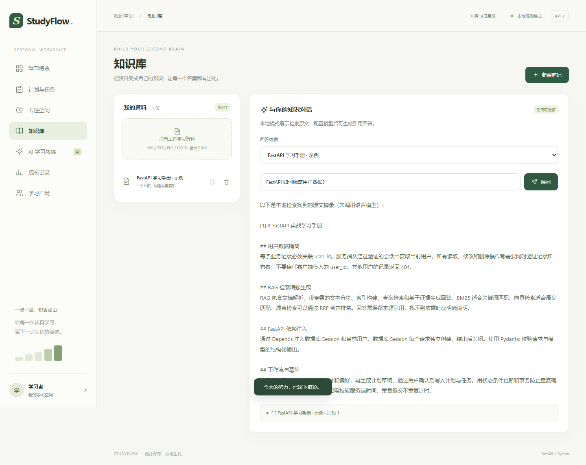
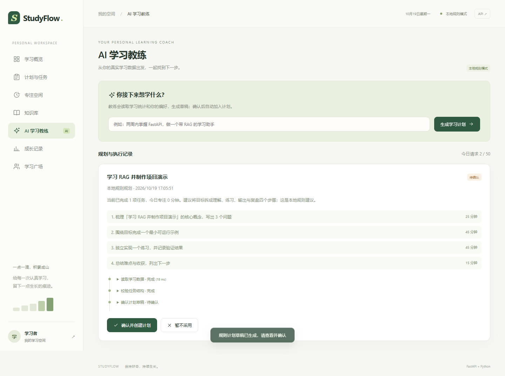

# 三分钟体验

## 准备

运行 `start.ps1`（Windows）或 `sh start.sh`（Linux / macOS），打开 `http://127.0.0.1:8000`，注册一个自己的测试账户。

点击「计划与任务 → 载入示例资料」，或将仓库 `examples/knowledge/` 下的两份 Markdown 文件上传到知识库。不会自动创建固定公共账号或导入真实用户数据。

无需模型密钥也能演示业务与检索摘录；接入模型后可体验真实生成。界面会明确区分规则规划和模型规划。

## 演示顺序

1. **学习概览（20 秒）**：查看计划与统计，勾选一项任务，确认进度变化。
2. **知识库（60 秒）**：选择「FastAPI 学习笔记」，提问「怎样防止访问别人的数据？」；查看引用片段并打开原文。再切换另一份资料，观察回答范围变化。
3. **索引维护（20 秒）**：配置向量服务后，查看资料的向量就绪状态，使用右侧按钮原地重建索引。新模型结果通过后才替换旧索引。
4. **AI 学习教练（40 秒）**：输入「用一周掌握 FastAPI 基础」，展开读取数据、校验和确认步骤；确认后进入计划页查看新任务。
5. **学习广场（40 秒）**：使用普通窗口与无痕窗口登录两个账户，在两个窗口中打开广场，发送消息并观察即时推送。

可另外选择「1 分钟体验」测试专注计时和刷新恢复。专注完成由服务端时间校验，提前结束不会累计时长。

## 截图

| 知识库 | 学习规划 |
| --- | --- |
|  |  |

截图使用隔离测试账户和示例资料生成。浏览器回归命令：

```powershell
.\.venv\Scripts\python scripts/test_postgres.py --browser
```

当前地址是本机地址，公开 GitHub 源码不等于上线网站。公网体验需要另行部署，源码、文档和截图可直接用于代码审阅与面试讲解。
